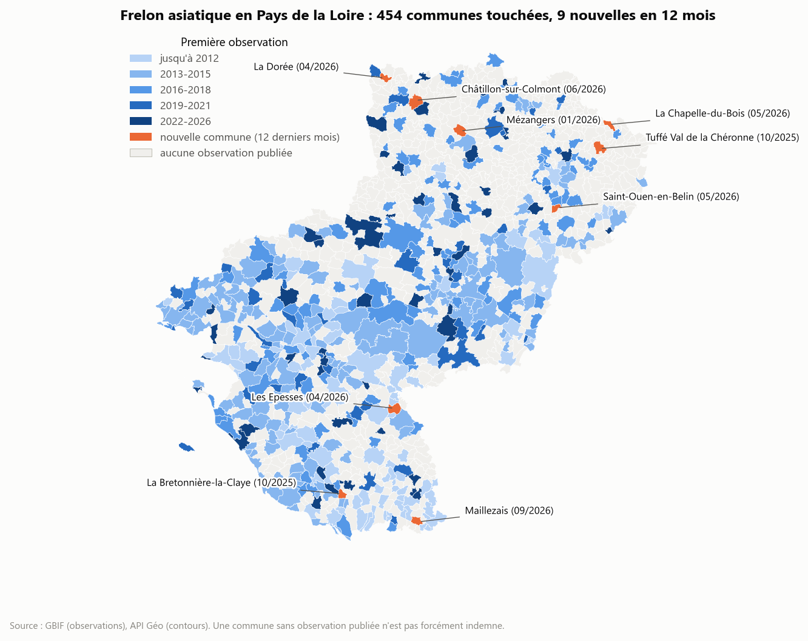
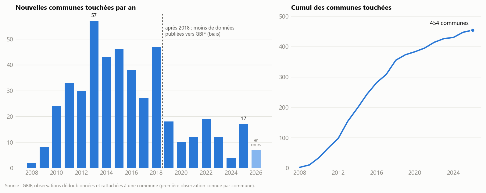
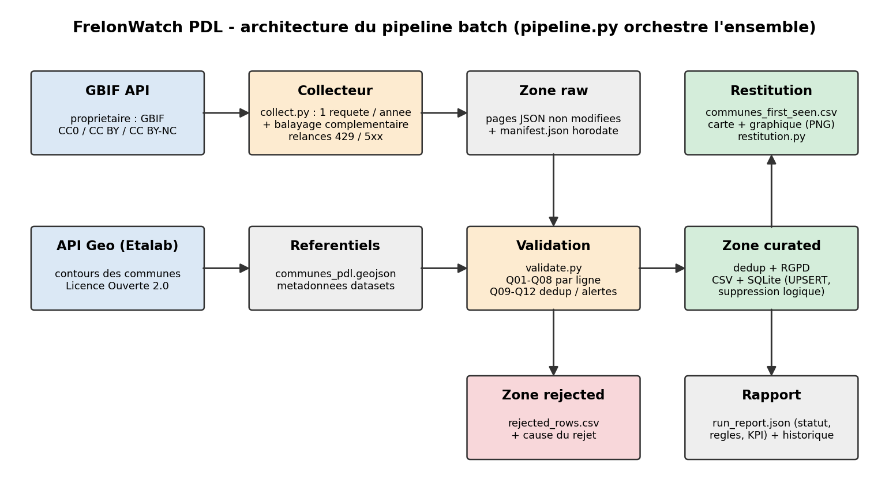

# FrelonWatch PDL — progression du frelon asiatique en Pays de la Loire

Projet personnel de collecte de données — ESEO 2026-2027, module *Architectures BD et collecte de données*.

> **Question centrale : à quelle vitesse le frelon asiatique progresse-t-il dans les Pays de la Loire,
> et quelles communes ont vu leurs premières observations récemment ?**

**Utilisateur** : un apiculteur ou un groupement de défense sanitaire apicole.
**Décision** : dans quelles communes placer en priorité les pièges à fondatrices au printemps.

Le pipeline collecte les observations publiques de *Vespa velutina* sur GBIF. Il les contrôle, les
déduplique entre plateformes, les rattache à une commune, supprime les données personnelles, puis
publie un jeu de données curated, une base SQLite, des indicateurs et une carte.

Le cadrage détaillé de la séance 1 (fiche, cas d'usage, KPI, grain, dictionnaire) est dans
[docs/fiche_projet.md](docs/fiche_projet.md). Les décisions d'architecture sont dans [docs/adr/](docs/adr/).
La synthèse du projet (5 pages) est dans [docs/synthese/synthese.pdf](docs/synthese/synthese.pdf). Elle est
générée à partir de `synthese.html`, imprimé en PDF avec un navigateur.

## Résultats (exécution du 12/10/2026)

| Indicateur | Valeur |
|---|---|
| Observations collectées (raw) | 1 777 |
| Rejetées (avec cause) | 129 |
| Doublons fusionnés | 109, dont 20 groupes inter-plateformes, tous confirmés par le clustering GBIF |
| Observations curated | 1 539 |
| Communes touchées depuis 2008 | 454 |
| Nouvelles communes en 2025 | 17 |
| Communes touchées pour la première fois ces 12 derniers mois | 9 |
| Statut qualité | `PASS_WITH_WARNINGS` (avertissement Q08 uniquement) |

### Restitution





Fichiers produits pour l'utilisateur, régénérés à chaque exécution :
- `reports/figures/carte_communes.png` : année d'arrivée du frelon par commune ; les communes touchées
  pour la première fois ces 12 derniers mois sont en orange et nommées ;
- `reports/figures/progression.png` : nouvelles communes par an et cumul ;
- `data/curated/communes_first_seen.csv` : une ligne par commune, avec la première et la dernière
  observation, les observations de printemps (fondatrices) et l'indicateur `newly_colonised_last_12_months` ;
- `data/curated/progression_annuelle.csv` : nouvelles communes et cumul par année.

## Sources et conditions d'utilisation

| Source | Rôle | Accès | Licence |
|---|---|---|---|
| [GBIF](https://www.gbif.org) — API `occurrence/search` | Observations (source principale) | Public, sans clé | Par ligne : CC0 1.0, CC BY 4.0 ou CC BY-NC 4.0 |
| [API Géo](https://geo.api.gouv.fr) — `communes?codeRegion=52` | Contours des communes (enrichissement) | Public, sans clé | Licence Ouverte Etalab 2.0 |

Dernier accès : 12/10/2026. Filtres GBIF : `taxonKey=1311477` (*Vespa velutina*), `gadmGid=FRA.12_1`
(Pays de la Loire), `country=FR`. Pourquoi GBIF : [ADR-001](docs/adr/ADR-001-source-gbif.md).

Le projet est non commercial, donc les trois licences sont utilisables. La règle Q06 vérifie la licence
de chaque ligne, et `data/curated/attributions.csv` fournit l'attribution exigée par CC BY (titre, DOI,
lien de chaque jeu de données). L'analyse complète des sources, des licences et du RGPD est dans
[docs/source_assessment.md](docs/source_assessment.md).

## Prérequis et installation

Python 3.11 ou plus récent, et un accès Internet (api.gbif.org, geo.api.gouv.fr). Aucun compte ni
aucune clé d'API n'est nécessaire.

```bash
git clone https://github.com/behaghelroch-dev/frelon-pdl.git
cd frelon-pdl
python -m venv .venv
# Windows : .venv\Scripts\activate      Linux / macOS : source .venv/bin/activate
pip install -r requirements.txt
```

> Sous Windows avec *Smart App Control*, les DLL de pandas installées dans un venv peuvent être bloquées.
> Dans ce cas, créez le venv avec `python -m venv --system-site-packages .venv` pour réutiliser le
> pandas déjà installé.

## Exécution

```bash
python src/pipeline.py --collect        # nouvelle collecte GBIF puis traitement complet
python src/pipeline.py                  # retraite la dernière collecte présente en zone raw (~4 s)
python src/pipeline.py --demo-invalid   # démonstration : 8 lignes piégées (sorties dans data/demo/)
python src/collect.py --years 2025,2026 # collecte seule, sur quelques années
python -m pytest -q                     # 34 tests unitaires
python docs/make_architecture.py        # régénère le schéma d'architecture
```

`--collect` dure environ 30 s, et environ 50 s à la première exécution, qui télécharge le référentiel
des communes (15 Mo, mis en cache 30 jours). Toute la configuration (espèce, zone, seuils de qualité,
chemins) est dans `config/pipeline.yaml`.

**Résultat attendu** : le terminal se termine par une ligne
`Statut PASS_WITH_WARNINGS : … lignes en entree, … acceptees, … rejetees, … en curated`, et
`reports/run_report.json` contient le détail. Relancer `python src/pipeline.py` donne
`"inserted": 0` dans la section `database` du rapport (idempotence).

## Architecture



1. **Collecte** (`collect.py`) : une requête par année (plus un bloc historique 1600-2003), pour rester
   sous le plafond de 100 000 résultats par requête. Pages de 300 lignes, relances exponentielles sur
   les erreurs 429 et 5xx, abandon propre sur les erreurs 4xx. Un **balayage complémentaire** sans
   filtre d'année (fichiers `scan_all_*.json`) récupère ensuite les observations qu'aucune tranche
   annuelle ne renvoie, car GBIF ne sait pas filtrer sur une année absente. Chaque page est écrite
   **octet pour octet** dans `data/raw/gbif_<horodatage>/`, avec un `manifest.json` qui trace la
   requête et les comptes.
2. **Extraction** (`extract.py`) : aplatit les pages JSON en table ; du balayage complémentaire, elle ne
   garde que les `gbifID` absents des tranches annuelles.
3. **Profilage** (`profile_data.py`) : `reports/profile_raw.json` contient les types, les valeurs
   manquantes, les doublons, les plages de valeurs et les modalités fréquentes.
4. **Standardisation** (`transform.py`) : typage, dates normalisées (heure locale convertie en UTC,
   intervalles et années seules gérés), licences normalisées, rattachement à une commune par test
   point-dans-polygone (`reference.py`).
5. **Validation** (`validate.py`) : séparation entre lignes acceptées et rejetées, avec la liste des
   règles violées.
6. **Déduplication, RGPD et chargement** (`transform.py`, `load.py`) : fusion des doublons, suppression
   des données personnelles, écriture atomique des CSV, UPSERT SQLite historisé.
7. **Restitution et rapport** (`restitution.py`, `pipeline.py`) : carte, graphique, indicateurs et
   rapport d'exécution.

### Décisions d'architecture (ADR)

| ADR | Décision |
|---|---|
| [ADR-001](docs/adr/ADR-001-source-gbif.md) | API GBIF plutôt que les exports de la plateforme Frelon / INPN |
| [ADR-002](docs/adr/ADR-002-stockage-csv-sqlite.md) | CSV + SQLite locaux plutôt qu'une base serveur |
| [ADR-003](docs/adr/ADR-003-cle-metier-et-historisation.md) | Clé métier spatio-temporelle, UPSERT et suppression logique |

## Arborescence

```
frelon-pdl/
├── README.md, requirements.txt, .gitignore
├── config/
│   ├── pipeline.yaml          # paramètres (source, zone, seuils, chemins)
│   └── data_contract.yaml     # contrat de données v1.0 (grain, 31 champs, règles)
├── data/
│   ├── raw/                   # collectes complètes (non versionnées) + sample_source.json
│   ├── reference/             # cache communes + métadonnées des datasets (non versionné)
│   ├── curated/               # observations.csv, communes_first_seen.csv, progression_annuelle.csv,
│   │                          # attributions.csv, frelon_pdl.sqlite (non versionnée)
│   └── rejected/rejected_rows.csv
├── docs/                      # fiche_projet.md, source_assessment.md, architecture.png,
│   └── adr/                   # décisions d'architecture ADR-001 à ADR-003
├── reports/                   # run_report.json, profile_raw.json, figures/, runs/ (historique)
├── src/                       # collect, extract, profile_data, reference, validate,
│                              # transform, load, restitution, pipeline, make_sample
└── tests/test_quality.py
```

## Contrat et dictionnaire de données

Le contrat [config/data_contract.yaml](config/data_contract.yaml) fixe le grain (*un signalement de
présence du frelon en un lieu arrondi à ~100 m, à une date donnée, toutes sources confondues*), la clé
primaire, les 31 champs publiés (type, caractère obligatoire, valeurs autorisées), les champs exclus pour
le RGPD et les règles de qualité. Le dictionnaire commenté avec des exemples est dans
[docs/fiche_projet.md](docs/fiche_projet.md#étape-4--grain-et-dictionnaire).

## Règles de qualité

| ID | Dimension | Condition | Action | Échecs (12/10) |
|---|---|---|---|---|
| Q01 | Complétude | latitude et longitude renseignées | Rejeter | 0 |
| Q02 | Domaine | point dans une commune des Pays de la Loire | Rejeter | 8 |
| Q03 | Validité | date lisible, ≥ 2004, non future, précision ≤ 1 an | Rejeter | 16 |
| Q04 | Domaine | incertitude de localisation ≤ 5 000 m | Rejeter | **107** |
| Q05 | Validité | espèce *Vespa velutina*, rang espèce ou infra-spécifique | Rejeter | 0 |
| Q06 | Conformité | licence CC0, CC BY ou CC BY-NC | Rejeter | 0 |
| Q07 | Cohérence | `occurrenceStatus = PRESENT` | Rejeter | 0 |
| Q08 | Complétude | incertitude de localisation renseignée | Signaler | 343 |
| Q09 | Unicité | clé métier unique | Dédupliquer | 109 |
| Q10 | Fraîcheur | dernière observation datant de moins de 120 jours | Alerter | 0 (29 j) |
| Q11 | Complétude | reçu = annoncé, et tranches + balayage complémentaire = total | Alerter | 0 |
| Q12 | Conformité | aucun nom d'observateur dans les sorties (hors `attributions.csv`, voir plus bas) | Alerter (statut FAIL) | 0 / 1 002 noms |

La règle qui rejette le plus est **Q04** : 107 observations ont une localisation à plus de 5 km, ce qui
ne permet pas d'attribuer une commune de façon fiable. Les rejets Q02 sont des points sur l'estran ou
juste au-delà de la limite régionale, car les contours GADM utilisés par GBIF diffèrent légèrement des
contours INSEE. Les rejets Q03 sont des observations sans date ou datées par un intervalle de plusieurs
années. Chaque ligne rejetée est conservée dans `data/rejected/rejected_rows.csv`, avec la liste des
règles violées (`reject_reasons`) et le fichier raw d'origine (`source_file`).

Le mode `--demo-invalid` injecte une ligne par règle Q01 à Q07, plus un faux doublon. Chacune est
rejetée par la règle attendue, et le doublon est fusionné.

## Déduplication et idempotence

Le raisonnement et les alternatives écartées sont dans [ADR-003](docs/adr/ADR-003-cle-metier-et-historisation.md).

**Clé métier** : `observation_key` = SHA-1 de (espèce, jour, latitude à 3 décimales, longitude à 3
décimales). Une même observation peut arriver sur GBIF par plusieurs canaux, par exemple iNaturalist et
l'inventaire national Frelon du MNHN.

1. **Doublons techniques** : un `gbifID` vu deux fois (chevauchement de pages) est supprimé.
2. **Doublons métier** : les enregistrements qui partagent la même clé sont fusionnés. On garde la
   localisation la plus précise, puis la licence la plus ouverte. Les identifiants fusionnés sont
   conservés dans `source_gbif_ids`, et `n_source_records` / `n_source_datasets` indiquent combien de
   lignes et de sources ont été regroupées.
3. **Contrôle croisé** : les 20 groupes inter-plateformes détectés sont tous aussi marqués
   `isInCluster` par l'algorithme de clustering de GBIF.

**Rejeu** : les CSV sont réécrits de façon atomique (fichier temporaire puis remplacement), et la base
SQLite utilise `observation_key` comme clé primaire avec `INSERT … ON CONFLICT DO UPDATE` (UPSERT) et
une contrainte `UNIQUE` sur `gbif_id`. Une seconde exécution donne `inserted: 0`.

**Historisation** : le CSV est un snapshot de la dernière collecte, alors que la base garde
l'historique. Quatre colonnes propres à la base suivent chaque ligne : `is_active`, `first_seen_run`,
`last_seen_run` et `removed_at_run` (identifiant de la collecte). Une observation absente d'une nouvelle
collecte n'est pas supprimée : elle passe à `is_active = 0` (suppression logique), et elle est réactivée
si elle réapparaît. Ce marquage n'a lieu que si la collecte est **complète** (toute la zone, Q11 sans
échec) : une collecte partielle (`--years`) ne peut donc pas « supprimer » de lignes à tort. Si GBIF
corrige les coordonnées ou la date d'un enregistrement, sa clé métier change : l'ancienne ligne est
remplacée, sans violer la contrainte `UNIQUE` sur `gbif_id`. Pour lire les observations actuelles :
`SELECT * FROM observations WHERE is_active = 1`. La collecte du 12/10 a ainsi inséré 9 nouvelles
observations par rapport à celle du 23/09, sans aucune suppression.

## Rapport d'exécution

Chaque exécution écrit `reports/run_report.json` (et une copie historisée dans `reports/runs/`) :
lignes en entrée, acceptées, rejetées et fusionnées, échecs par règle, alertes, colonnes personnelles
supprimées, KPI, statistiques de la base (`inserted`, `marked_removed`, `reactivated`, `active_rows`…),
figures produites, statut `PASS` / `PASS_WITH_WARNINGS` / `FAIL`, et durée.

## Données personnelles

Les champs `recordedBy`, `identifiedBy`, `rightsHolder`, `nick`, `verbatimLocality` et les champs
associés sont supprimés dès la sortie de la zone raw. Celle-ci n'est pas versionnée ; seul un extrait
masqué l'est. Les coordonnées sont arrondies à environ 100 m, et `source_channel` est normalisé, car
certains titres de jeux de données contiennent un nom.

La règle Q12 vérifie à chaque exécution qu'aucun nom d'observateur de la zone raw ne se retrouve dans
`observations.csv`, `communes_first_seen.csv`, `progression_annuelle.csv` et `rejected_rows.csv`.
**Exception volontaire** : `attributions.csv` contient le titre complet de chaque jeu de données, et 5
titres CardObs incluent le nom de leur auteur (« Données naturalistes de X »). Cette mention est exigée
par la licence CC BY, qui impose de citer le créateur ; ce sont des métadonnées publiées volontairement
par leur auteur. Justification détaillée :
[docs/source_assessment.md](docs/source_assessment.md#données-personnelles-rgpd).

## Limites connues et améliorations

- **Biais d'observation** : la baisse apparente des nouvelles communes après 2018 (environ 43 par an
  entre 2013 et 2018, contre 4 à 19 ensuite) reflète surtout une **baisse de la publication vers GBIF**
  (moins de données de l'inventaire national), pas un ralentissement de l'espèce. Les signalements
  terrain des GDSA (plateforme Frelon asiatique, déclarations en mairie) ne sont pas sur GBIF. Une
  absence d'observation ne signifie pas une absence de frelon.
- **Observations sans année** : 17 enregistrements n'ont pas de date exploitable (champ vide ou
  intervalle de plusieurs années). Le balayage complémentaire les récupère, et Q03 en rejette 16 avec
  leur cause. La dernière, datée par un intervalle de 365 jours, est acceptée sans mois ni phase.
- **Clé métier à environ 100 m** : deux plateformes qui arrondissent différemment la même observation
  (centroïde de commune contre point GPS) ne sont pas fusionnées. Amélioration : s'appuyer sur l'API de
  clustering GBIF (`/occurrence/{id}/experimental/related`).
- **Passage en production** : planification hebdomadaire (cron ou GitHub Actions), téléchargement GBIF
  avec DOI pour la citation, et une seconde source terrain (signalements des GDSA).

## Usage d'outils d'intelligence artificielle

Conformément aux consignes du module, voici les usages significatifs d'IA dans ce projet.

**Outil** : Claude Code (modèle Claude Opus 5.5, Anthropic), utilisé comme assistant dans VS Code.

**Usages (sessions des 23/09 et 12/10/2026)** :
- *Collecte* : conception du balayage complémentaire qui récupère les 17 observations sans année
  (`collect.py`, `extract.py`, règle Q11).
- *Base de données* : historisation par suppression logique et correction du cas d'un `gbif_id` qui
  change de clé métier (`load.py`).
- *Restitution* : carte des communes et graphique de progression (`restitution.py`).
- *Vérification* : exécution complète depuis un clone neuf du dépôt et contrôle RGPD indépendant, qui a
  mis en évidence l'exception d'`attributions.csv` documentée ci-dessus.
- *Documentation* : rédaction des ADR, mise à jour du README et du schéma d'architecture, première
  version de la synthèse PDF.
- Tests unitaires correspondant à chacun de ces ajouts.

**[À COMPLÉTER PAR L'AUTEUR : usages éventuels d'IA pendant les séances 1 à 3 (cadrage, premier
pipeline, règles de qualité…), ou mention qu'il n'y en a pas eu.]**

**Contrôle humain** : chaque modification a été relue, exécutée et testée (34 tests, exécutions réelles
sur GBIF). L'auteur a vérifié les choix de conception et peut en expliquer le fonctionnement.
